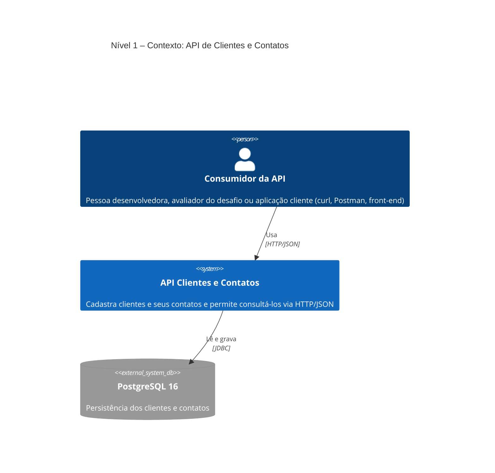
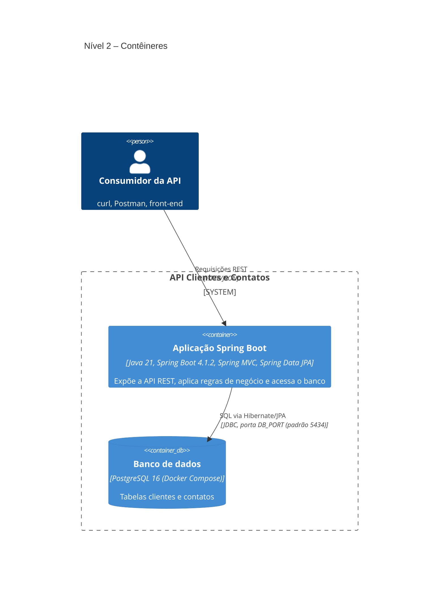
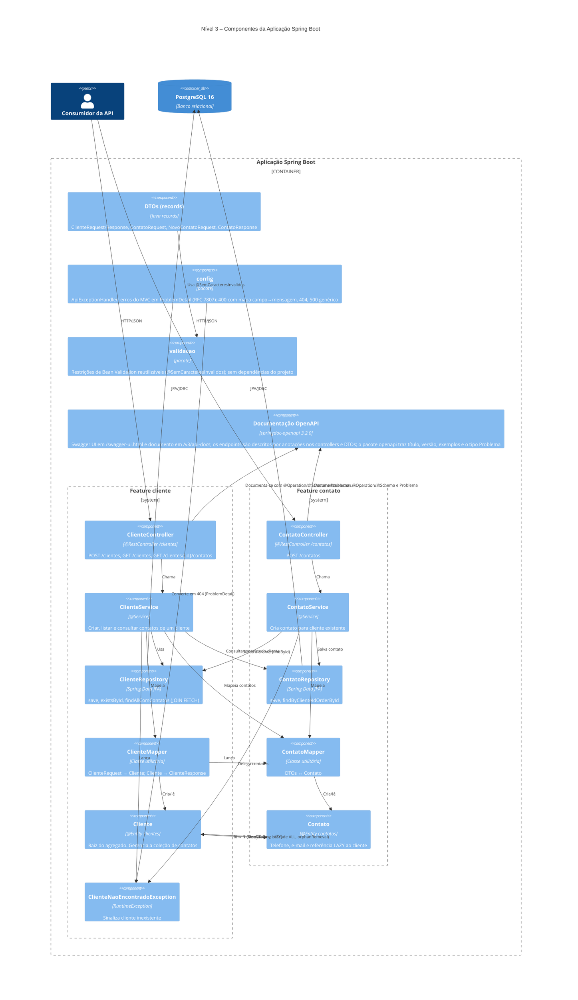
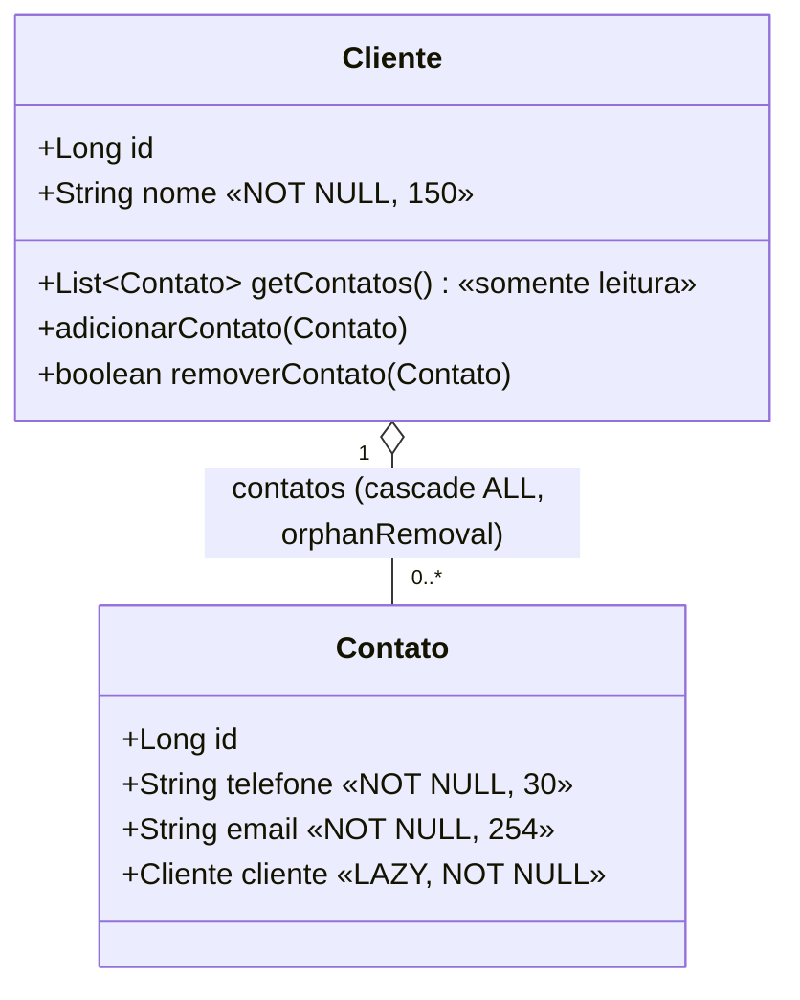
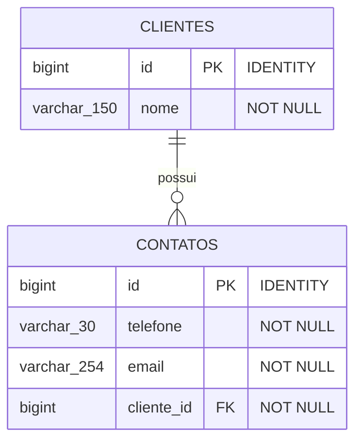
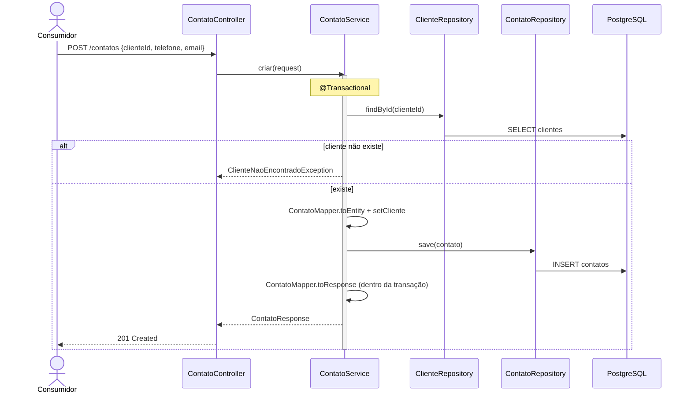
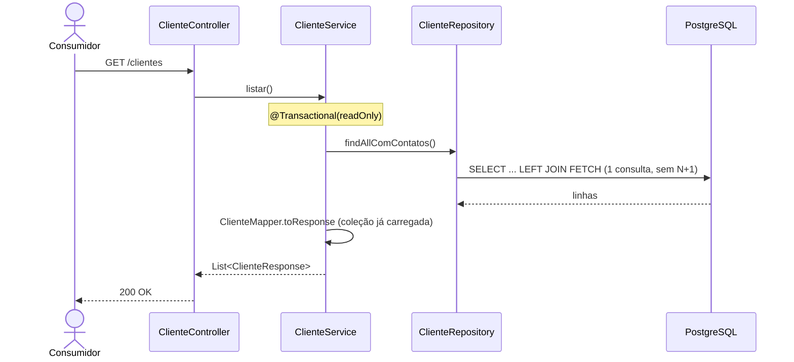

# Documentação de arquitetura (modelo C4)

API REST de **clientes e contatos** (1 cliente → N contatos), desafio técnico backend.
Os diagramas usam [Mermaid](https://mermaid.js.org/) (sintaxe C4), então renderizam direto no GitHub (no VS Code, com a extensão Markdown Preview Mermaid Support).

> **Estado documentado:** branch `main` com validação (#10), tratamento global de erros (#11), testes com Testcontainers (#14) e Swagger/OpenAPI (#15) implementados.
> Itens **ainda não implementados** aparecem marcados como *(planejado)*:
> Flyway (#16), Dockerfile (#17), CI (#18), paginação (#29) e resiliência a queda do banco (#34).

---

## Nível 1 – Contexto do sistema

Quem usa o sistema e com o que ele conversa.

| Elemento | Descrição |
|---|---|
| Consumidor da API | Qualquer cliente HTTP. Não há autenticação nem autorização (fora do escopo do desafio). |
| API Clientes e Contatos | O sistema construído neste repositório. |
| PostgreSQL 16 | Banco relacional. Em desenvolvimento roda em Docker Compose, publicado só em `127.0.0.1`. |

---

## Nível 2 – Contêineres

Unidades executáveis e de armazenamento.

| Contêiner | Tecnologia | Responsabilidade |
|---|---|---|
| Aplicação Spring Boot | Java 21, Spring Boot 4.1.2, Maven Wrapper, Lombok | API REST, validação, erros em `ProblemDetail`, transações, mapeamento DTO ↔ entidade, persistência com JPA e documentação interativa (Swagger UI). Empacotada como jar (`desafio-nubank-java-0.0.1-SNAPSHOT.jar`). |
| Banco de dados | PostgreSQL 16, imagem oficial, volume `pgdata`, *healthcheck* `pg_isready` | Guarda os dados. O schema é criado pelas migrations do Flyway (`src/main/resources/db/migration`, executadas na subida da aplicação); o Hibernate só o valida (`ddl-auto: validate`). Os testes de integração aplicam as mesmas migrations em um PostgreSQL descartável do Testcontainers. |

### Configuração e ambientes

- Credenciais vêm do `.env` (não versionado; modelo em `.env.example`) ou de variáveis de ambiente: `DB_HOST`, `DB_PORT`, `DB_NAME`, `DB_USER`, `DB_PASSWORD`. `DB_USER` e `DB_PASSWORD` não têm valor padrão na aplicação.
- O mesmo `.env` alimenta o Docker Compose e o Spring (`spring.config.import: optional:file:.env[.properties]`).
- Perfil `dev` (ativado por `./mvnw spring-boot:run`): SQL formatado e log do Hibernate em `debug`.
- `spring.jpa.open-in-view: false`: todo mapeamento para DTO acontece dentro da transação do service.

---

## Nível 3 – Componentes (Aplicação Spring Boot)

O código é organizado **por feature** (`cliente`, `contato`) no pacote base `io.github.suzanacavalcante.desafio`, seguindo camadas Controller → Service → Repository. Os pacotes transversais são `config` (tratamento de erros), `validacao` (restrições reutilizáveis) e `openapi` (documentação da API).

### Responsabilidades

| Componente | Papel | Observações relevantes |
|---|---|---|
| `ClienteController` | Camada web de `/clientes`. | `POST` devolve **201**. `@Valid` no corpo; erros viram `ProblemDetail` (ver `config`). |
| `ContatoController` | Camada web de `/contatos`. | `POST` devolve **201**; `clienteId` vem no corpo. |
| `ClienteService` | Casos de uso de cliente. | `criar` é `@Transactional`; `listar` e `contatosDoCliente` são `readOnly`. Cliente inexistente → `ClienteNaoEncontradoException`. |
| `ContatoService` | Caso de uso de criação de contato. | Busca o cliente com `findById`, associa e salva, mapeia dentro da transação. |
| `ClienteRepository` | Acesso a `clientes`. | `findAllComContatos` usa `left join fetch` ordenado por `c.id, ct.id` (evita N+1). |
| `ContatoRepository` | Acesso a `contatos`. | `findByClienteIdOrderById` garante ordem estável. |
| `ClienteMapper` / `ContatoMapper` | Conversão DTO ↔ entidade. | `ContatoMapper.toEntity` **não** associa o cliente; quem associa é o service ou `Cliente.adicionarContato`. |
| `Cliente` | Raiz do agregado. | `getContatos()` é somente leitura; alterações via `adicionarContato` (idempotente; rejeita contato de outro cliente) e `removerContato`. Limite de `nome`: 150. |
| `Contato` | Entidade filha. | Limites: `telefone` 30, `email` 254. FK `cliente_id` NOT NULL. |
| DTOs | Contrato da API. | `record`s com Bean Validation (restrições próprias em `validacao`). |

---

## Nível 4 – Código

Modelo de domínio e esquema físico. Para o restante, o código-fonte é a referência.

### Modelo de classes (domínio)

### Esquema físico

A FK gerada pelo Hibernate **não** tem `ON DELETE CASCADE` nem índice em `contatos.cliente_id`; ambos estão previstos para a migração Flyway (#16).

### Contrato da API

| Método | Rota | Corpo | Sucesso | Erros |
|---|---|---|---|---|
| POST | `/clientes` | `{ nome, contatos?: [{ telefone, email }] }` | 201 `ClienteResponse` | 400 |
| POST | `/contatos` | `{ clienteId, telefone, email }` | 201 `ContatoResponse` | 400, 404 |
| GET | `/clientes` | – | 200 lista de `ClienteResponse` com contatos | – |
| GET | `/clientes/{id}/contatos` | – | 200 lista de `ContatoResponse` | 400 (`{id}` inválido), 404 |

> Todo erro sai como `ProblemDetail` (`application/problem+json`): validação → 400 com `erros` (campo → mensagem, em português, sem ecoar o valor rejeitado); JSON malformado ou `{id}` de tipo errado → 400; `ClienteNaoEncontradoException` → 404; qualquer outra exceção → 500 genérico (stack trace só no log). `GET /clientes` não tem erros esperados do cliente.

### Fluxo: criar contato (`POST /contatos`)

### Fluxo: listar clientes (`GET /clientes`)

---

## Decisões arquiteturais

| Decisão | Motivo |
|---|---|
| Pacotes **por feature** | Alta coesão; cada feature carrega controller, service, repository, mapper e DTOs. |
| `Cliente` como **raiz do agregado** | Coleção encapsulada (lista imutável) e invariantes em `adicionarContato`/`removerContato`. |
| **DTOs em `record`**, sem expor entidades | Evita `LazyInitializationException` na serialização e recursão JSON cliente↔contato. |
| `open-in-view: false` + mapeamento no service | Acesso preguiçoso só dentro da transação; falha cedo se alguém mapear fora. |
| `JOIN FETCH` na listagem | Uma consulta em vez de N+1 (ver a ressalva: sem paginação, o custo cresce com o volume). |
| Flyway + `ddl-auto: validate` | O schema tem uma única origem versionada (as migrations, as mesmas em dev, testes e produção); o Hibernate falha na subida se as entidades divergirem dela. FK com `ON DELETE CASCADE` e índice em `contatos.cliente_id`. |
| Erros em `ProblemDetail` (RFC 7807) | Formato padrão e único; sem stack trace e sem ecoar o valor rejeitado. |
| springdoc-openapi 3.2.0 | Série compatível com o Spring Boot 4.1; documentação por anotações nos controllers e DTOs. |
| Testes com Testcontainers | Testes independentes do banco local, do Compose e do `.env`. |
| Credenciais sem valor padrão | Segredos nunca ficam no código; vêm do `.env`/ambiente. |

## Qualidade e testes

- Pirâmide: testes unitários (entidades, mappers, services com Mockito), `@WebMvcTest` nos controllers, `@DataJpaTest` no repositório e testes de API que sobem o contexto completo (`*ApiTest`).
- Testes de contrato ainda não atendidos ficam sob a tag `bug-conhecido` e **falham de propósito** até a issue correspondente ser feita (não tratar como regressão); a tag é excluída por padrão (`excludedGroups` no `pom.xml`); rode com `-Dgroups=bug-conhecido -DexcludedGroups=nenhum`.
- Os testes de integração usam um PostgreSQL 16 descartável do **Testcontainers** (um container por execução, ligado por `@ServiceConnection`); precisam de Docker, mas não do Compose nem do `.env`.

## Evolução prevista

| Issue | Mudança | Impacto no C4 |
|---|---|---|
| #17 | Dockerfile + Compose | Aplicação passa a ser contêiner junto com o banco |
| #18 | GitHub Actions | Novo sistema externo (CI) no nível de contexto |
| #29 | Paginação em `GET /clientes` | Contrato da listagem muda (parâmetros de página); sem alterar a estrutura de componentes |
| #34 | Resiliência a queda do banco | Timeout curto e resposta 503 com `Retry-After`, tratados em `config` |
